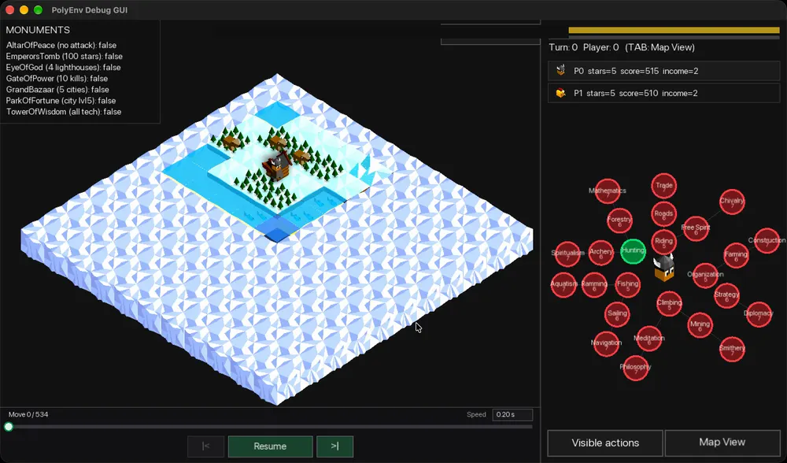

<div align="center">

# PolyBot

**A neural strategy-game bot trained with self-play reinforcement learning.**

[](docs/installation.md)
[](https://pytorch.org/)
[](https://github.com/FryOne2137/PolyEnv)
[](LICENSE)



</div>

PolyBot learns to play an unofficial Polytopia-like game in [PolyEnv](https://github.com/FryOne2137/PolyEnv). One network encodes the visible map, player context, action history and every legal move, with policy, value and belief heads. Training uses PPO/PPG self-play; belief-guided MCTS is an optional stage.

## ⚡ Install

Use an activated Python 3.12 environment. Native build tools and CUDA setup are covered in the [installation guide](docs/installation.md).

```bash
git clone https://github.com/FryOne2137/PolyBot.git
cd PolyBot
python -m pip install -r requirements.txt
```

## 🎮 Self-play

Use your trained checkpoint as `models/model.pt`; pretrained weights are not bundled. Play and save ten games without training:

```bash
python scripts/play_self.py --model models/model.pt --mode flat --games 10 --seed 2137 --max-moves 1600 --visible-action-history 32 --output-dir runs/selfplay --device auto
```

Open the saved `.polygame` files in the PolyEnv replay viewer. `--device auto` selects an available GPU or CPU.

## 🏁 Evaluate

Compare against another checkpoint on paired maps with player swaps:

```bash
python scripts/evaluate.py --mode flat --model-a models/model.pt --model-b models/reference.pt --games 40 --seed 1531842 --max-moves 1600 --visible-action-history 32 --device auto
```

Score is `(wins + 0.5 × draws) / games`. Self-play shows behavior; matches against a reference measure playing strength.

---

[MIT license](LICENSE) · [Citation](CITATION.cff) · [Contributing](.github/CONTRIBUTING.md)

Unofficial research project, not affiliated with The Battle of Polytopia or its developers.
