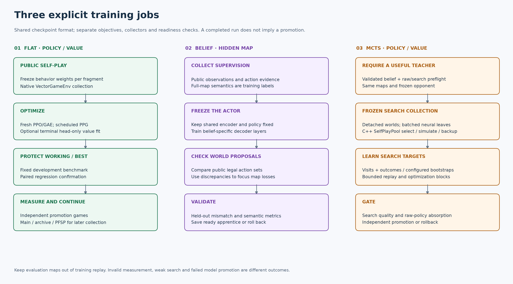

# PolyBot

**Reinforcement learning for a strategy game under fog of war.**

PolyBot trains neural agents in [PolyEnv](https://github.com/FryOne2137/PolyEnv), an unofficial Polytopia-like engine. It includes fast flat PPO/PPG self-play, structured hidden-map belief learning, and an optional belief-guided MCTS training stage.


**Status:** research software under active development. The relational architecture is available for new experiments; existing checkpoints retain their saved architecture. The current source tree includes no pretrained weights or independently established playing-strength results. Review the [publication checklist](docs/public_release.md) before exposing historical artifacts.

## Start here

| Goal | Guide |
| --- | --- |
| Install and check native dependencies | [Installation](docs/installation.md) |
| Create a model, train, evaluate, save games | [Training guide](docs/training.md) |
| Understand inputs, heads and action scoring | [Architecture](docs/architecture.md) |
| Inspect the new relational scorer | [Relational architecture and benchmark](docs/relational_architecture.md) |
| Understand fresh PPO fragments and terminal labels | [Flat rollouts](docs/flat_rollouts.md) |
| Configure critic fitting, rollback and experiment records | [Flat improvements](docs/flat_improvements.md) |
| Interpret results and reproduce experiments | [Reproducibility and model card](docs/reproducibility.md) |
| Prepare a source-only public release | [Publication checklist](docs/public_release.md) |

## Installation

Use **Python 3.12**, Git and a C++20 compiler for the native engine. See the platform-specific [installation guide](docs/installation.md) for Windows, Linux, macOS and CUDA.

```bash
git clone https://github.com/FryOne2137/PolyBot.git
cd PolyBot
python -m venv .venv
```

Activate the environment, then install the dependencies:

```bash
python -m pip install --upgrade pip
python -m pip install -r requirements-dev.txt
python scripts/check_environment.py --smoke
python -m pytest
```

Scripts run directly from the repository and add `src/` themselves. No manual `PYTHONPATH` is needed for the CLI or the configured test suite. PolyEnv is pinned to a tested revision rather than a moving branch.

## A small first experiment

Create a reproducible **random** relational model:

```bash
python scripts/init_model.py --architecture relational --seed 2137 --model-out models/demo/initial.pt --project runs/demo --name initialization
```

This creates weights and an initialization record; it does **not** train the model. A short teacher run checks the training path:

```bash
python scripts/train_vector_teacher.py --model-in models/demo/initial.pt --model-out models/demo/teacher.pt --num-envs 8 --steps 200 --updates-per-step 1 --num-threads 2 --visible-event-history 32 --seed 3187 --device cpu --project runs/demo --name teacher-smoke
```

Compare the two checkpoints using their raw legal-action policy:

```bash
python scripts/evaluate.py --mode flat --model-a models/demo/teacher.pt --model-b models/demo/initial.pt --games 20 --max-moves 900 --visible-action-history 32 --seed 1531842 --device cpu
```

These are smoke experiments, not a convergence recipe or proof of strength. Continue with the [flat league recipe](docs/training.md#flat-population-training) for a longer experiment.

Save ten example games for the PolyEnv replay viewer:

```bash
python scripts/play_self.py --model models/demo/teacher.pt --mode flat --games 10 --max-moves 1600 --visible-action-history 32 --seed 712391 --output-dir runs/demo/games --device cpu
```

## Three separate training modes



| Entry point | What it learns | Environment/search |
| --- | --- | --- |
| `train_flat.py` | Policy and value using PPO/PPG, population sampling and guarded checkpoint selection | Native `VectorGameEnv`; no MCTS |
| `train_belief.py` | Hidden-map decoder with supervised labels and legal-action discrepancy evidence | Routed collection/calibration; actor and shared encoder frozen in belief-only training |
| `train_league_mcts.py` | Policy/value from validated search targets | Native `SelfPlayPool`, belief particles and MCTS |

`train_league.py` also exposes a guarded `auto` curriculum. The older `train_pipeline.py`, teacher and standalone self-play scripts remain available for experiments. They are not interchangeable with the three main entry points; consult each script's `--help`.

## Model and information flow

- The shared encoder consumes a **player-visible** map, public global features and visible event history.
- The relational policy jointly scores action type, semantic options, costs, context, and source/target/city representations. Runtime IDs act as pointers rather than learned ordinal features.
- Value predicts a scalar in `[-1, 1]`. An optional belief branch predicts hidden semantic map fields.
- Flat action selection uses policy directly. It does not reconstruct a hidden world before every move.
- MCTS operates on detached sampled worlds that must respect the public observation and legal-action constraints.
- Ground truth is training supervision, never a policy/value input or an oracle world for search. Legacy training-only targets are documented separately.

The relational variant is selected by the **checkpoint configuration**, not by renaming a file. Loading a factorized or attention checkpoint preserves that architecture. A new relational experiment needs its own initialization and compatible league population.

## Results, artifacts and limits

Models are saved as `.pt`; runs contain metrics, configurations, events and summaries. Flat scientific artifacts can additionally include source snapshots, initial/selected models and optimization continuation state. These may contain local paths or private experiment details and are ignored by Git.

Playing strength is measured by paired matches against explicit opponents, with map seeds, player swaps, move limits and confidence diagnostics. Low belief mismatch, lower loss, an EMA model or a faster forward pass do not by themselves establish stronger play.

The bundled [CPU benchmark](docs/benchmarks/relational_cpu.json) measures synthetic tensor workloads, not game strength, CUDA throughput or total league wall time. See the [model card and reproduction notes](docs/reproducibility.md) before interpreting results.

## Development

```bash
python -m pytest
python scripts/check_docs.py
python scripts/audit_public.py
python scripts/render_diagrams.py --output-dir docs/assets
```

See [CONTRIBUTING.md](CONTRIBUTING.md) for tests and diagram regeneration, [SECURITY.md](SECURITY.md) for sensitive reports, and [research references](docs/references.md) for the algorithmic background. Generated figures have editable Python sources; historical root figure filenames are maintained as compatibility copies.

## License, attribution and citation

PolyBot code is provided under the [MIT license](LICENSE). PolyEnv is a separate project with its own code, dependencies and attribution. This is an unofficial research project and is not affiliated with The Battle of Polytopia or its developers. Proprietary game assets are not included here.

For research, use [CITATION.cff](CITATION.cff) and report the exact commit, native engine revision, architecture, seeds and training configuration.
