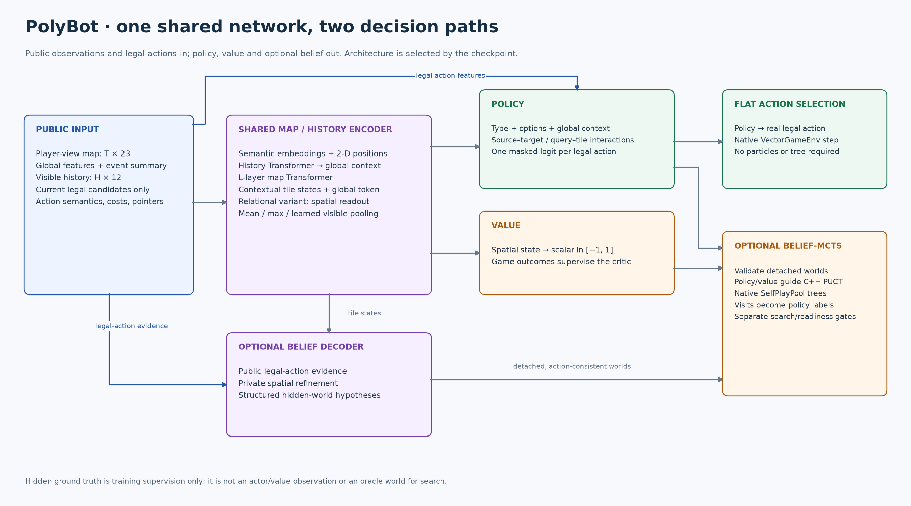
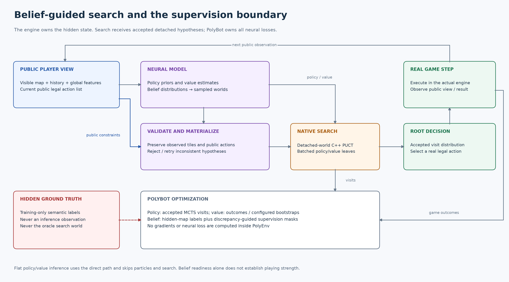

# Architecture and information flow

A detailed [single-network diagram](assets/model-network.pdf)
shows the actual default layer dimensions. Its [renderer](../scripts/render_network.py)
and parameter manifest are versioned with the figure.

## Shared public-state encoder

The model receives a player-view map with 23 categorical fields plus an own-city
population field per tile, nine legacy global features plus 126 observer/public
context features, a 12-field visible-event summary and an optional bounded
history of compact 12-field event tokens. The history encoder pools visible
events into the global token before the map Transformer. This is a bounded
history model, not a recurrent hidden state carried between network calls.
[Semantic history v2](history_encoder.md) embeds categories and X/Y coordinates
without clipping valid unit types together.

The context contains the observer's technology bits and tribe, initial player
count, own player ID, public player scores, explicitly known statuses, and a
three-way map type. Unknown values have separate masks. Opponent technology and
tribe data never enter this vector. One tile encoder jointly fuses categorical
fields, including city level, with normalized own-city population and its known
mask: at width 192 its shared MLP is `194 -> 192 -> 192`, followed by LayerNorm.
There is no separate population branch. See the exact
[observation schema and architecture versions](observation_context.md).

The Transformer returns a global state and contextual tile representations.
The relational variant adds mean, maximum and learned attention pooling over
revealed tiles to the global state. Its default initializer uses width 192,
eight map layers, eight attention heads and action interaction width 64.

A [shared action-set encoder](shared_actions.md) then encodes every legal
candidate at width 64. Four-head induced attention uses 16 latent tokens and
returns one contextual vector per action. Policy, value and belief all consume
these shared features. Native adapters reserve the complete action space and
remove only padding before the model, never actual legal candidates.

## One action encoder and one policy scorer

Every profile uses the same policy path:

`all legal actions + map -> shared action encoder -> A x 64 tokens -> MLP -> A logits`

The policy MLP is `LayerNorm(64) -> Linear(64,128) -> GELU -> Linear(128,1)`.
There is no separate relational scorer, old raw-action embedding table, or
parallel sum of logits. The output has one score per currently legal candidate,
followed by the padding mask, rather than a fixed vocabulary of all possible
moves. Value and belief consume the same contextual action tokens.

The default `policy_architecture="relational"` now names the map-encoding profile:
it omits runtime unit/city/origin IDs as learned features, resolves IDs as public
pointers, and uses spatial state readout. The historical `factorized` and
`attention` names remain available for base-map encoding ablations; neither
selects an alternative action scorer. See [shared actions](shared_actions.md)
and the [spatial encoding details](relational_architecture.md).

## Value and belief

Value reads both the map state and the complete contextual action set, then
predicts a scalar in `[-1, 1]`. Its terminal targets use candidate-relative
outcomes: win `+1`, draw `0`, loss `-1`. A learned estimate is not a calibrated
win probability unless evaluated as such. Extra head-only critic fitting can
update value without changing the encoder or policy.

The optional belief branch conditions tile representations on the shared legal
action tokens, refines them spatially and predicts semantic map distributions.
Structured sampling handles terrain, settlements, units and their attributes.
Observed tiles must be preserved; public action constraints reject inconsistent
world proposals. Runtime IDs for sampled entities are materialization details,
not hidden semantic labels the policy is asked to memorize.

The three branches belong to one model. Dedicated training stages choose which
parameters receive gradients; flat forward calls normally skip belief decoding.

## Flat decision path

Public observation → shared encoder → legal-action scores → selected legal
action → real `VectorGameEnv` step. Belief reconstruction and MCTS are not
prerequisites for this path.

## Optional belief-MCTS path

Public observation and legal actions seed belief particles. Accepted detached
worlds are searched with policy priors and value estimates, using PolyEnv's
native pools for tree selection, simulation and backup. Visit distributions
provide policy targets; completed outcomes and configured bootstraps provide
value supervision. Selective MCTS can search a subset of training positions.

`root_shield` provides additional root-action mapping protection. It does not
make a world with an inconsistent public legal-action list valid. Strict
calibration, rejection statistics and raw-versus-search preflight remain needed.

## Ground-truth boundary

The engine owns the actual hidden state. `full_map_numpy()` and native
ground-truth labels are training-only supervision, not neural observation
features or oracle search worlds. The policy and value consume player-view
features; MCTS uses detached hypotheses rather than cloning the true hidden map.

Some older standalone training helpers also use authoritative economy for a
training-only horizon target. This does not turn it into an inference input.
These legacy helpers are not equivalent to the terminal-only supervision of
the dedicated flat collector. Keep training modes explicit in experiments.

## Engine versus learner

PolyEnv determines legal actions, executes rules, materializes detached worlds
and reports action differences. PolyBot owns neural inference, losses,
optimization, sampling configuration, replay, league selection and metrics.
An action-discrepancy mask focuses supervised map learning; it is not a
differentiable loss computed inside the engine.
