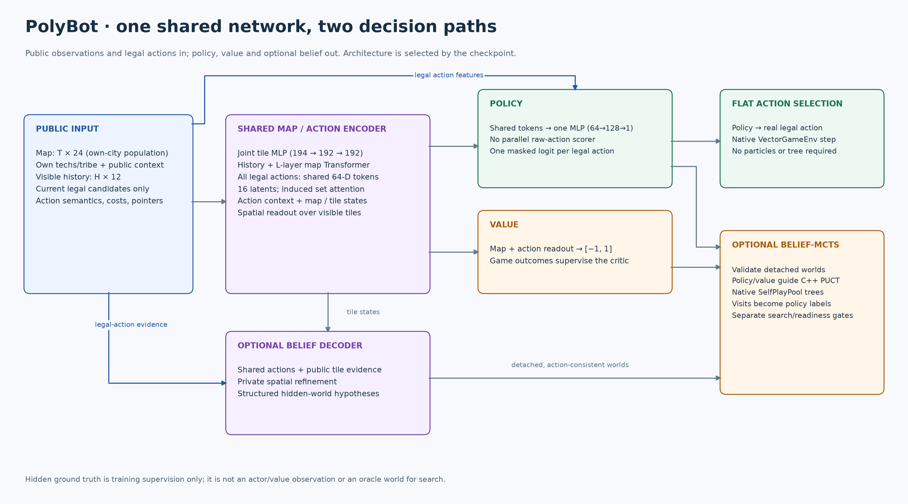

# Relational policy/value architecture

The default `ModelConfig(policy_architecture="relational")` is one network with
a shared map/history encoder and one shared legal-action encoder. All training
entry points use this model. The historical profile names `factorized` and
`attention` now select only base-map encoding ablations, without spatial readout
or runtime-ID filtering; they do not restore old scorers.



## Joint action encoding and single policy scorer

The shared action encoder combines type, semantic options, normalized economic
features, global context, source/target/city states and relative geometry.
Public city and unit IDs are lookup keys resolved by sorted pointers, not learned
numeric features. Unit-only actions recover their source through a public unit
pointer. Tile projections are computed once in the narrow action width of 64.

Four-head induced attention reads every legal action into 16 learned latent
tokens and writes the context back to every action. There is no A-by-A attention
matrix. At fixed board size this scales linearly with action count; pointer
lookup adds a logarithmic board-size factor. [Complete native action lists](shared_actions.md)
reach the model; only padding is removed.

Policy has one path from each shared action token through
`LayerNorm(64) -> Linear(64,128) -> GELU -> Linear(128,1)` to a masked logit.
The separate `RelationalActionPolicy`, old factorized and raw-action attention
scorers have been removed. A regression test verifies that this shared encoder
and MLP can learn source-dependent destination preferences that an independent
additive source/target score cannot fit. Value and belief consume the same action
tokens; they do not require a second raw-action encoder.

## Spatial state readout

Mean, maximum and learned attention pooling over revealed tile states supplement
the global token before policy/value prediction. Empty visibility yields zero
pooled features with finite gradients. The extra head-only critic fit still
detaches this representation.

The relational map encoder omits runtime unit, city and origin-ID embeddings.
History unit IDs become presence indicators. The legacy scaled pending-city
ID is omitted from global input; city-linked legal actions can name the
relevant public tile. Positions, types, ownership and other semantic features
remain available. Tests verify policy/value invariance under consistent ID
renaming.

Flat inference skips hidden-map reconstruction. The existing structured belief
branch remains available for its dedicated training stage and optional MCTS.
This is not a learned latent dynamics model.

## New experiments and old checkpoints

```bash
python scripts/init_model.py --architecture relational --seed 2137 --d-model 192 --layers 8 --heads 8 --action-interaction-dim 64 --model-out models/demo/initial.pt --project runs/demo --name initialization
```

This creates recorded random weights; it does not train. It refuses to overwrite
an existing model. Follow the [training guide](training.md) for bootstrap,
flat self-play, calibration and optional search.

Checkpoints record joint tile encoder version 2 and action encoder version 2.
Both model loading and optimizer continuation reject older action-scoring
schemas explicitly. Use fresh random initialization and separate checkpoint,
replay and league directories. Supported new checkpoints can be compared by the
standalone evaluator even when their map-encoding profiles differ.

## Throughput benchmark

```bash
python scripts/benchmark_architecture.py --device cuda --batch-size 8 --map-size 11 --actions 32,256,1024 --history 32 --repeats 30 --warmup 5 --training --output runs/demo/architecture-benchmark.json
```

This measures synthetic forward and optional forward/backward/AdamW workloads,
with identical tensor sizes and encoder dimensions. It excludes engine,
rollout and validation time.

A historical CPU run, before joint tile encoder v2 and the shared action encoder, used width 192, eight layers,
rank 64, 11×11 maps, history 32, batch four, one thread and 12 repeats after three
warmups:

| Actions | Factorized forward | Relational forward | Factorized training step | Relational training step |
| --- | ---: | ---: | ---: | ---: |
| 32 | 19.84 ms | 21.33 ms | 64.86 ms | 63.46 ms |
| 256 | 23.10 ms | 24.14 ms | 65.41 ms | 69.62 ms |
| 1024 | 32.61 ms | 24.83 ms | 80.96 ms | 74.38 ms |

Raw metadata/results: [relational_cpu.json](benchmarks/relational_cpu.json).
This short measurement does not predict CUDA performance or league wall time.

With the current joint encoders and these dimensions, the default relational
profile has 6,843,809 parameters, including 163,648 in the shared action encoder.
The flat path uses 4,879,298 parameters; belief-specific layers add 1,964,511.
The benchmark script compares map-encoding profiles with the same current action
encoder/scorer. Re-run it for current timings; the table above records the earlier
architecture with different scorers. Greater expressiveness alone is not evidence
of stronger play without multi-seed matches.
