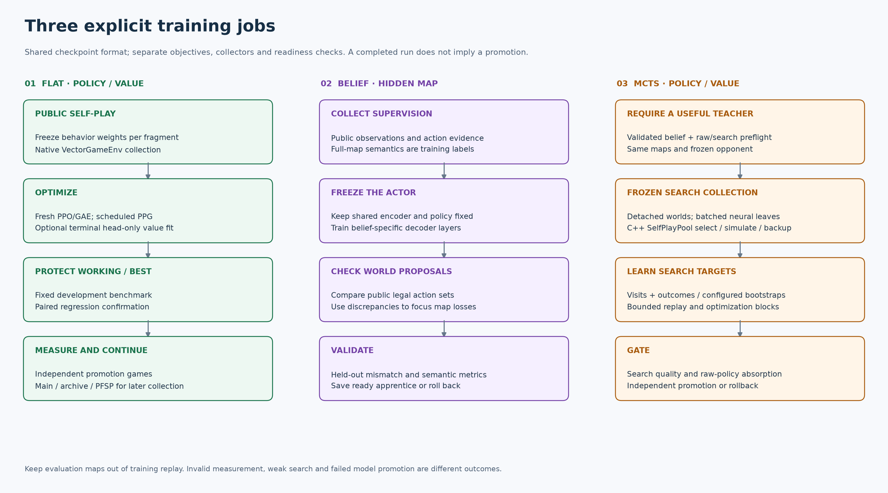

# Training and evaluation

Start with [installation](installation.md) and a successful environment smoke
check. Commands below use relative forward-slash paths and single lines so
they can be copied into PowerShell or a POSIX shell.



## Initialize an experiment

```bash
python scripts/init_model.py --architecture relational --seed 2137 --model-out models/demo/initial.pt --project runs/demo --name initialization
```

This records random initialization, architecture, seed, source and initial
weights. It does not train. Use a new checkpoint directory and database for a
new architecture. The initializer refuses to overwrite an existing model.

A short supervised policy bootstrap is a practical installation check:

```bash
python scripts/train_vector_teacher.py --model-in models/demo/initial.pt --model-out models/demo/teacher.pt --num-envs 8 --steps 200 --updates-per-step 1 --num-threads 2 --visible-event-history 32 --seed 3187 --device cpu --project runs/demo --name teacher-smoke
```

Increase the bootstrap budget for a real experiment. The heuristic teacher
provides useful starting behavior; it is not an optimal policy or a benchmark
of general playing strength.

## Flat population training

`train_flat.py` forces the flat training stage and flat champion mode. It runs
PPO/GAE and optional PPG against frozen opponents with PFSP, guarded block
selection and separate promotion games. It rejects incompatible MCTS collection
and distillation settings.

```bash
python scripts/train_flat.py --champion-in models/demo/teacher.pt --checkpoint-dir models/demo/league --checkpoint-prefix agent --league-db runs/demo/league.sqlite --project runs/demo --name flat --seed 110351 --evaluation-seed 1531842 --rounds 2 --population-size 6 --direct-population-envs 8 --direct-population-steps 4000 --direct-population-max-steps 8000 --post-bootstrap-population-steps 4000 --post-bootstrap-population-max-steps 8000 --direct-population-block-steps 2000 --direct-population-gate-games 40 --direct-population-diagnostic-gate-games 20 --promotion-games 100 --historical-games 40 --direct-population-ppo-rollout-steps 128 --direct-population-ppo-epochs 1 --direct-population-ppo-minibatch-size 128 --direct-population-ppo-top-advantage-fraction 1.0 --direct-population-ppo-terminal-advantage-weight 0.75 --direct-population-shaping-weight 0.05 --direct-population-shaping-final-weight 0.0 --flat-population-terminal-replay-value-weight 0.0 --flat-population-regression-confirm-games 80 --no-breakthrough-exploiter --max-moves 1600 --direct-gate-max-moves 1600 --learning-rate 0.00001 --visible-action-history 32 --device cuda
```

Use `--device cpu` for a small CPU experiment and reduce the budgets. No wall
time or promotion is guaranteed by these settings. Read the returned
`league_champion_path` and `league_challenger_path`; a run can complete without
promoting any model.

To continue an accepted challenger, add `--challenger-in` with the actual saved
checkpoint while retaining the champion and its league database as the reference.
Reusing only the initial champion starts the candidate from that champion.

The current [joint tile encoder](observation_context.md) is architecture version
2, the [shared action encoder](shared_actions.md) is version 2, and the
[semantic history encoder](history_encoder.md) is version 2. Start from
random initialization, with a new checkpoint directory and
league database. Previous tile/history-encoder or parallel-scorer checkpoints and optimizer continuation
files cannot initialize this architecture. Once version-2 weights exist, resume
normally with compatible `--challenger-in` or `--flat-resume-state` files.
Revalidate belief before entering MCTS with changed model weights or inputs.
Use fresh replay as well: old stored observations may have incomplete action
lists. Native `max_actions` CLI settings are capacity hints; current adapters
always deliver every legal action and trim only padding.

The opt-in [mixed-domain flat curriculum](flat_curriculum_plan.md) adds twelve
tribes, staged map sizes/types and weighted mixed arenas. Enable it with
`--flat-curriculum`; the separate collector keeps other training stages unchanged.

### What a block does

1. Freeze the current behavior policy for each synchronous rollout fragment.
2. Collect public transitions, bootstrap unfinished fragments, then update PPO.
3. Run configured PPG/value phases; keep true full-game labels separately from
   old actor data.
4. Screen and evaluate candidates against the development opponents. Confirm
   apparent regression using paired candidate/reference games when configured.
5. Keep the best checkpoint separately from safe working weights. Roll back
   confirmed regressions and their optimizer state.
6. Evaluate selected raw/EMA variants and run the independent promotion gate.

The native collector is budgeted in **vector steps**. A fragment or block end
does not end the game or create a draw label. With persistent environments,
unfinished games can span blocks. `--max-moves` sets the dedicated flat gate
horizon unless overridden by `--direct-gate-max-moves`; it is not a universal
native training-episode timeout.

Terminal results supervise value. The actor can mix terminal advantage with
GAE and configured dense shaping. Shaping is an auxiliary learning signal;
promotion uses match outcomes. Capturing the decisive capital is a game win
under the engine's rules, rather than a separate definition of success.

See [rollout semantics](flat_rollouts.md) and [flat improvements](flat_improvements.md)
for sample age, head-only value fitting, paired rollback, cache and resume limits.

## Belief-only training

Use this stage when preparing hidden-map hypotheses for search. It freezes the
actor and shared encoder and trains the belief-specific layers. Engine action
differences provide evidence masks; PolyBot computes the supervised losses.

```bash
python scripts/train_belief.py --champion-in models/demo/teacher.pt --belief-apprentice-path models/belief/apprentice.pt --checkpoint-dir models/belief --checkpoint-prefix agent --league-db runs/belief.sqlite --project runs/belief --name calibration --seed 51073 --evaluation-seed 1531842 --rounds 2 --champion-mode mcts --value-bootstrap-games 0 --population-games 32 --population-updates-per-game 4 --belief-replay-updates 256 --belief-calibration-replay-capacity 20000 --population-workers 4 --population-max-envs 4 --population-offline-collection --population-belief-search-mode root_shield --belief-action-equivalence-target 0.02 --belief-action-equivalence-min-particles 512 --belief-calibration-eval-games 8 --simulations 16 --particles 4 --belief-particle-temperature 0.15 --max-moves 1600 --visible-action-history 32 --learning-rate 0.00001 --device cuda
```

This entry point uses **league arguments**, including `--champion-in`.
Historical `--positions ... --model-out ...` recipes belong to an earlier CLI
and do not work with the current `train_belief.py`.

Check held-out mismatch, actual sample counts, structural rejection/fallback
rates, semantic NLL and city/unit precision/recall. A `ready=1` marker applies
to specific weights and validation settings. It is neither exact hidden-state
recovery nor evidence of stronger play. More games or retries do not guarantee
the configured target will be reached.

Replay-only updates can use `--population-games 0 --belief-replay-updates N`
after a compatible replay exists. Preserve its provenance and keep validation
maps out of training. Do not silently mix old map sizes or history conventions.

## MCTS policy/value training

Start this stage only with a validated apprentice belonging to the same champion.
Keep its validation settings consistent or revalidate through the belief/auto
stage first. The dedicated MCTS stage does not silently train an unready decoder.

```bash
python scripts/train_league_mcts.py --champion-in models/demo/teacher.pt --belief-apprentice-path models/belief/apprentice.pt --checkpoint-dir models/mcts --checkpoint-prefix agent --league-db runs/mcts.sqlite --project runs/mcts --name search --seed 81013 --evaluation-seed 1531842 --rounds 2 --champion-mode mcts --value-bootstrap-games 0 --population-games 16 --population-updates-per-game 2 --population-workers 4 --population-max-envs 4 --population-offline-collection --population-belief-search-mode root_shield --belief-action-equivalence-target 0.02 --belief-action-equivalence-min-particles 512 --belief-calibration-eval-games 8 --mcts-simulation-ladder 16 --simulations 16 --particles 4 --belief-particle-temperature 0.15 --max-moves 1600 --visible-action-history 32 --learning-rate 0.00001 --device cuda
```

The preflight compares raw candidate policy with candidate search against the
same fixed opponent and paired maps. Invalid/incomplete evaluation is distinct
from search failing to improve. If the teacher search is not useful, a rung
can finish without collection or weight updates; raising simulations alone is
not a repair for poor value or inconsistent beliefs.

Accepted search positions produce visit-distribution targets. Collection can be
offline/frozen and selective. Real game moves remain constrained by the engine's
public legal list. For the model/search boundary see [architecture](architecture.md).

## Evaluation and saved games

```bash
python scripts/evaluate.py --mode flat --model-a models/demo/teacher.pt --model-b models/demo/initial.pt --games 100 --max-moves 1600 --visible-action-history 32 --seed 711391 --device cuda
python scripts/play_self.py --model models/demo/teacher.pt --mode flat --games 10 --max-moves 1600 --visible-action-history 32 --seed 712391 --output-dir runs/demo/games --device cpu
python scripts/league_report.py --league-db runs/demo/league.sqlite --limit 10
```

Raw evaluation does not require belief reconstruction. Two checkpoints with
different architectures can be compared through the standalone flat evaluator;
a training league currently requires compatible model configurations.

`play_self.py` writes native `.polygame` files and a manifest for the PolyEnv
viewer. Its default nonzero temperature samples actions; use `--temperature 0`
for greedy example games. Saved games are demonstrations, not an independent
benchmark. A game stopped at a move limit is truncated.

## Other entry points

| Script | Purpose |
| --- | --- |
| `train_teacher.py` | Scalar heuristic behavior-cloning bootstrap |
| `train_vector_teacher.py` | Native vector teacher bootstrap |
| `train_flat_actor_critic.py` | Older standalone vector actor-critic experiment |
| `train_self_play.py` | Standalone global MCTS self-play |
| `train_self_play_pool.py` | Standalone native pool trainer |
| `train_pipeline.py` | Older multi-stage orchestration; not the dedicated flat league |
| `train_league.py` | Configurable guarded curriculum, including `auto` |
| `benchmark_flat_evaluation.py` | Real-engine throughput probe for single/mixed flat arenas |

Use `--help` for the actual options. Do not infer one script's options from
another script with a similar name.
